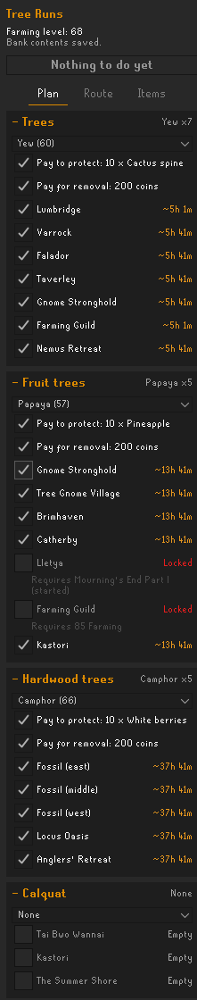
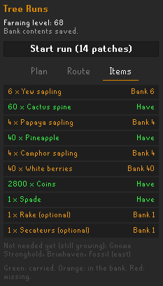
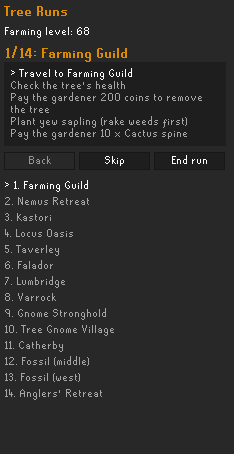

# Tree Run Planner

Plan your farming tree runs, see exactly what to bring, and get guided patch by patch.

## Features

**Plan your run**
- One section per patch type: trees, fruit trees, hardwood, calquat, spirit trees, celastrus, redwood and crystal trees.
- Pick a sapling for each type, or **None** to leave it out. The list only shows trees your Farming level can plant.
- Choose whether to pay the gardener to protect each tree and to remove grown trees.
- Tick the patches you want to use. Locked patches are greyed out with what they require: quests, Farming Guild tiers, Sailing level, and so on.
- Spirit tree selections respect your Farming level's limit on planted spirit trees.
- See every patch's state: empty, growing (with time left), ready, diseased or dead. Patches the Time Tracking plugin has already seen are picked up automatically.

**Know what to bring**

- The Items tab adds up the saplings, protection payments, removal coins and tools the run needs.
- Each line shows whether you're carrying it, how many to take out of the bank, or how many you're missing. Noted payments count.
- Trees that are still growing are left out until they're ready.

**Follow the route**
- Stops start in a sensible order grouped by area. Drag them in the Route tab to make the run your own.

**Get guided**

- **Start run** walks you through each patch: check health, remove the tree, plant, protect.
- It moves on automatically once you've planted and the gardener has accepted your payment.
- Optional outlines for the patch, the gardener, and the inventory item you need next (sapling, payment, spade or axe).
- An on-screen checklist and a hint arrow.
- **Shortest Path** integration: if you have the Shortest Path plugin, turn this on to get a path to each patch.

## Settings

| Setting | Default | What it does |
|---|---|---|
| Highlight patch | On | Outline the patch you're working on |
| Highlight gardener | On | Outline the gardener when you need to pay them |
| Highlight items | On | Outline the inventory item for the current step |
| Hint arrow | On | Point the game's hint arrow at the current patch |
| Step checklist | On | Show the current patch's steps on screen |
| Highlight colour | Green | Colour of all outlines |
| Shortest Path integration | Off | Send the next patch to the Shortest Path plugin |

## Notes

- The game only sends a patch's state while you're near it. Growth times are estimated from when you last saw each patch and can't account for disease while you're away.
- Open your bank once so the Items tab knows what you have stored.
- Plans, routes and patch states are saved per account.

## Credits

Patch data is adapted from RuneLite's Time Tracking plugin and Quest Helper. Game data is checked against the [OSRS Wiki](https://oldschool.runescape.wiki/).

This plugin was built with AI-assisted development using Claude Opus.

## License

[BSD 2-Clause](LICENSE). Some files are adapted from RuneLite and Quest Helper; their notices are in [THIRD_PARTY_NOTICES](THIRD_PARTY_NOTICES).
